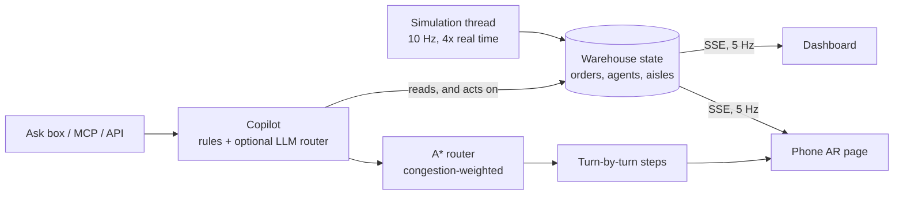

# PickPath AR: A Live Warehouse You Can Talk To

[](https://github.com/akhilsripada/pickpath-ar/actions/workflows/ci.yml)
[](https://akhilsripada.github.io/pickpath-ar/)
[](LICENSE)

PickPath AR runs a live fulfillment floor: orders arrive, pickers and robots move through aisles, and aisles jam up. Ask it *"where is order 4417?"* and it plans a congestion-aware route, shows turn-by-turn directions, and lays real-scale arrows on your floor through a phone camera (WebXR). Ask *"why are orders late?"* and it finds the bottleneck from live data and offers a fix you can apply with one sentence.

**[Try the live demo](https://akhilsripada.github.io/pickpath-ar/)** (runs in your browser) · **[AR navigation](https://akhilsripada.github.io/pickpath-ar/ar/)**

| | |
|---|---|
| **Impact of congestion-aware overflow routing** | On-time orders **86.2% → 99.7%**, 95th-percentile order time **315 s → 206 s** (10 simulated hours, [docs/results.md](docs/results.md)) |
| **Routing** | A* on a 114-node floor graph with congestion-weighted aisles: **44 µs** per route, verified against Dijkstra on 300 random cases |
| **Live updates** | Server-side simulation streamed to every screen over SSE 5×/second, so the laptop and the phone agree |
| **Copilot** | Answers in **under 1 ms** from live state; an optional LLM only routes free-form questions |
| **Dependencies** | **None** to run it. Python 3.11+ standard library only |

## Run it in one command

```bash
git clone https://github.com/akhilsripada/pickpath-ar.git
cd pickpath-ar
python run.py
```

Your browser opens the live floor at http://localhost:8000. Click **Why are orders late?**, then **Reroute pickers**, and watch aisle F clear. With Docker instead: `docker compose up`.

## Talk to it

| Where | How |
|---|---|
| **Dashboard** | Type in the Ask box, or click any order for directions. |
| **Phone, in AR** | Run `python run.py --host 0.0.0.0`, open `http://<your-laptop-ip>:8000/ar?order=4417` in Chrome on Android, tap **Start AR**, point at the floor and tap. Arrows appear at real scale along the route. Other browsers play a first-person walk-through instead. |
| **Claude, ChatGPT, Cursor** | Add the MCP server (below) and ask *"what's slowing the floor down?"* |
| **HTTP API** | `curl -X POST localhost:8000/api/ask -d '{"text":"where is picker P3?"}'` |

It understands: *where is order 4417?* · *why are orders late?* · *reroute pickers* · *where is robot R2?* · *order status*. Set `GEMINI_API_KEY` (Google's free tier works) to also handle free-form questions.

**MCP setup (Claude Desktop):** with PickPath running, add to `claude_desktop_config.json`:

```json
{"mcpServers": {"pickpath": {"command": "python3", "args": ["/full/path/to/pickpath-ar/mcp/pickpath_mcp.py"]}}}
```

Tools: `ask_pickpath`, `find_order` (returns walking directions and an AR link), `floor_status`, `reroute_pickers`.

## How it works



1. **The floor is a graph.** 8 aisles × 12 bays, two cross aisles, and the packing dock make 114 nodes. Every aisle edge knows which aisle it belongs to.
2. **Congestion is a cost.** An aisle fits two people. Each extra person multiplies walking cost there by 1.5× and pick time by 0.9×, so the router prefers the other entrance or the other copy of an item, and the simulation slows down the way a real aisle does.
3. **Orders flow** queued → picking → packing → shipped, each due 5 minutes after it arrives. An idle picker takes the cheapest of the four oldest waiting orders, which balances fairness against efficiency.
4. **Overflow slots.** Best sellers live in aisle F, with a second copy in aisle G. When overflow routing is on, each pick goes to whichever copy is cheaper to reach *right now*, including expected waiting time at the shelf.
5. **Directions** come from the route's corner points: the cross product of consecutive headings gives left or right, and the last step names the bay, the shelf level and which side it's on.

## Design decisions and trade-offs

**Measure the fix, don't just describe it.** `bench.py` replays the same 10 seeded waves with overflow routing off and on. It moves on-time delivery from 86.2% to 99.7%, and the worst wave from 35% to 97%. Throughput stays the same (about 300 orders an hour), so the gain comes from waiting less, not from working faster.

**A* with an admissible heuristic.** Straight-line distance never over-estimates walking distance, and congestion only adds cost, so A* stays optimal. A test checks it against plain Dijkstra on 300 random start, goal and congestion cases.

**The server owns the truth.** The simulation runs on one thread behind a lock, and every client gets the same snapshot stream. The dashboard interpolates between 5 Hz snapshots, so motion looks smooth without sending 60 updates a second.

**AR anchored to where you stand.** Indoor GPS doesn't work, so the phone page asks you to tap the floor where you're standing (the packing desk) and lays the route out at real scale from there, rotated to the direction you're facing. Progress comes from projecting the camera's position onto the route. A production version would anchor to a printed marker or a known landmark.

**The language model routes; the code answers.** Rules handle the common questions in under a millisecond. An LLM is only asked to map unusual phrasing onto the same fixed intents, its output is validated (a made-up order number is rejected), and every number in an answer comes from the simulation.

## Project layout

```
src/pickpath/
  floor.py        # floor graph, congestion-weighted A*, corner-only polylines
  sim.py          # orders, pickers, robots, congestion slowdown, overflow slots
  nav.py          # turn-by-turn directions from a route
  copilot.py      # plain-English questions -> intents -> answers from live state
server.py         # simulation thread, SSE stream, HTTP API, pages
web/index.html    # live dashboard: floor map, Ask box, orders, AR preview
web/ar.html       # phone page: three.js + WebXR navigation, 3D walk-through fallback
mcp/pickpath_mcp.py  # MCP server for AI assistants
bench.py          # overflow on/off experiment + routing and simulation speed
site/index.html   # browser-only demo published to GitHub Pages
tests/            # 26 tests: routing vs Dijkstra, simulation, copilot, live server, MCP
```

## Development

```bash
python -m unittest discover -s tests   # 26 tests, a few seconds
python bench.py                        # rewrites docs/results.md
python server.py --speedup 10          # faster floor
```

## What I'd do next

- Batch picking: one walk for several orders that share an aisle (a travelling-salesman route over bins).
- Learn congestion from real scan timestamps instead of a fixed capacity per aisle.
- Anchor AR to printed markers at each aisle end, so directions stay accurate over long walks.
- Slotting: move items between aisles overnight based on demand, so overflow is needed less.
